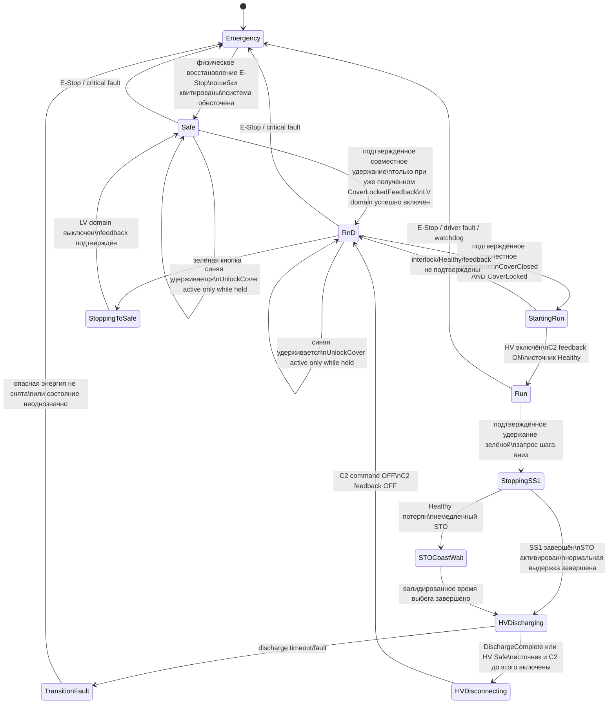

# MEN001 Dyno — спецификация Safety State Machine

Статус документа: рабочая спецификация желаемого поведения.  
Дата фиксации: 2026-10-17.  
Область: проект `MEN001_Dyno_v2`, TwinSAFE, управление энергетическими режимами и крышкой.

> Этот документ описывает требуемое поведение, а не подтверждает соответствие текущего кода. Любые изменения TwinSAFE должны отдельно пройти Verify/Build, проверку CRC, загрузку и validation на установке.

## 1. Назначение

Документ является единой точкой сверки для:

- состояний установки;
- действий оператора;
- переходов вверх и вниз;
- SS1, STO и реакции на `HV Source Healthy`;
- разряда высокого напряжения;
- управления замком защитной крышки;
- условий завершения каждого перехода;
- дальнейших изменений логики и тестирования.

## 2. Основные состояния

| Состояние | LV domain | HV/C2 | Двигатели | Крышка |
|---|---|---|---|---|
| `Emergency` | Обесточен или переводится в безопасное состояние | Отключается по аварийной процедуре | STO, возможен выбег | Заблокирована |
| `Safe` | Выключен | Выключен, напряжение разряжено | STO | Может быть открыта разрешённой командой |
| `R&D` | Включён | Выключен, напряжение разряжено | STO | Может быть открыта удержанием синей кнопки |
| `Run` | Включён | Включён | Работа разрешена | Закрыта и заблокирована |

Переходные фазы не являются самостоятельными рабочими режимами:

- `StartingRun`;
- `StoppingSS1`;
- `STOCoastWait`;
- `HVDischarging`;
- `HVDisconnecting`;
- `StoppingToSafe`;
- `TransitionFault`.

## 3. Органы управления

| Управление | Назначение |
|---|---|
| Физический E-Stop | Переход из любого состояния в `Emergency` |
| Зелёная кнопка `Safety Reset` | После подтверждённого удержания — один шаг вниз по иерархии состояний |
| Синяя кнопка `Release Cover` | После подтверждённого удержания — временное разрешение разблокировки; соленоид активен только пока кнопка удерживается |
| Зелёная + синяя | После подтверждённого совместного удержания — один шаг вверх, только если текущий режим и все interlock разрешают переход |

Основная иерархия:

```text
Safe  <->  R&D  <->  Run
```

- зелёная кнопка: движение справа налево;
- две кнопки около 2 секунд: движение слева направо;
- синяя кнопка отдельно: не меняет энергетическое состояние, а только управляет разрешённой разблокировкой крышки.

### 3.1. Однозначное распознавание кнопок

Распознавание выполняется отдельной state machine. После каждой команды или невалидной попытки требуется полное отпускание обеих кнопок и непрерывный фильтр очистки.

Предварительные времена:

- `T_RELEASE_FILTER = 2 s` — обе кнопки непрерывно отпущены;
- `T_CHORD_WINDOW = 0.5 s` — окно, в котором вторая кнопка преобразует одиночную попытку в попытку двух кнопок;
- `T_SINGLE = 1 s` — подтверждение стабильной одиночной кнопки;
- `T_BOTH = 2 s` — подтверждение стабильного совместного удержания.

Значения предварительные и должны быть окончательно утверждены испытанием.

Рекомендуемые состояния распознавателя:

```text
WaitAllReleased
 -> ReleaseQualify
 -> ArmedIdle
 -> GreenCandidate / BlueCandidate
 -> GreenActive / BlueActive
 -> TwoButtonsAttempt
 -> StepUpPulse
 -> WaitAllReleased
```

Требования:

1. В `ReleaseQualify` обе кнопки должны непрерывно оставаться `OFF` в течение `T_RELEASE_FILTER`. Любое нажатие до окончания фильтра аннулирует очистку; удерживаемая после этого кнопка не распознаётся. Нужны новое полное отпускание и полный фильтр.
2. После `ReleaseQualify` состояние `ArmedIdle` разрешает ровно одну новую попытку.
3. Первая нажатая кнопка переводит распознаватель в `GreenCandidate` или `BlueCandidate`. До завершения распознавания никакая команда и `UnlockCover` не выдаются.
4. Если зелёная остаётся единственной нажатой непрерывно `T_SINGLE`, формируется однократный `StepDown`.
5. Если синяя остаётся единственной нажатой непрерывно `T_SINGLE`, активируется `UnlockCover`; он остаётся активным только пока удерживается подтверждённая синяя и зелёная не нажата.
6. Если вторая кнопка нажата не позднее `T_CHORD_WINDOW` после первой, распознаватель необратимо переходит в `TwoButtonsAttempt`.
7. В `TwoButtonsAttempt` одиночные команды запрещены. Обе кнопки должны одновременно и непрерывно оставаться `ON` в течение `T_BOTH`, после чего формируется один импульс `StepUp`.
8. Если в `TwoButtonsAttempt` любой из двух входов пропал или моргает, таймер `T_BOTH` сбрасывается. При повторном появлении обеих кнопок отсчёт начинается заново, но попытка не понижается до зелёной или синей команды.
9. Если после входа в `TwoButtonsAttempt` одна кнопка остаётся нажатой, а вторая отпущена, система ничего не делает независимо от длительности такого состояния.
10. Выйти из `TwoButtonsAttempt`, `GreenActive`, `BlueActive` или состояния выполненной команды можно только после полного отпускания обеих кнопок и нового полного `T_RELEASE_FILTER`.
11. Последовательность `11 -> 10 -> 11` либо `11 -> 01 -> 11` никогда не создаёт одиночную команду.
12. Пример: синяя нажата на 0.5 секунды, затем отпущена и сразу удерживается зелёная. Команда не принимается: требуется полное отпускание обеих кнопок и новый `T_RELEASE_FILTER`.
13. Короткие повторяющиеся нажатия («игра на пианино») не вызывают действий.
14. Если вторая кнопка появилась позже `T_CHORD_WINDOW`, это не считается двухкнопочной комбинацией и не должно автоматически запускать другую команду; попытка блокируется до полного отпускания.

Главный инвариант:

> После распознавания попытки двух кнопок она никогда не может превратиться в одиночную команду без полного отпускания обеих кнопок и завершения нового фильтра очистки.

## 4. Общая диаграмма состояний



## 5. Управление крышкой

Замок имеет тип **normally locked / power-to-unlock**:

```text
UnlockCover = FALSE  -> крышка заблокирована
UnlockCover = TRUE   -> разрешено разблокировать крышку
```

Требования:

1. `UnlockCover` активируется только во время физического удержания синей кнопки.
2. Переход в `R&D` сам по себе не должен постоянно активировать соленоид.
3. В `Run` и во всех переходных фазах `UnlockCover = FALSE`.
4. После отпускания синей кнопки `UnlockCover` немедленно становится `FALSE`, но таймер ожидания закрытия не запускается.
5. Крышка может оставаться физически открытой неограниченно долго в `Safe` или `R&D`; это нормальное состояние и не является fault.
6. Оператор закрывает крышку механически. Только после захлопывания появляется `CoverLockedFeedback = TRUE`.
7. Для перехода вверх необходимы одновременно `CoverClosed = TRUE` и `CoverLockedFeedback = TRUE` ещё до принятия команды перехода.
8. Команда соленоида не заменяет feedback замка.
9. Если `CoverLockedFeedback` пропал при опасной энергии, выполняется аварийная реакция, а не обычный переход.
10. При движении, HV или незавершённом discharge крышка остаётся заблокированной.
11. Если крышка открыта в `Safe` или `R&D`, команда шага вверх игнорируется: состояние не меняется и fault не фиксируется.

### 5.1. Interlock силовых разъёмов и внешней системы

- `in_LV_Connector_Interlock` подтверждает посадку Fast Charge connector 48 V/LV.
- `in_HV_Connector_Interlock` подтверждает посадку Fast Charge connector HV.
- В `Safe` отсутствие любого из этих контактов только блокирует переход вверх без fault; после восстановления требуется новый жест.
- После выхода из `Safe` потеря любого connector interlock считается аварийным событием.
- `in_InterLock_NC_1` и `in_InterLock_NC_2` сохраняются как двухканальный `External Emergency Interlock` из стабильной версии.
- Потеря любого канала External Emergency Interlock считается Emergency; восстановление контакта не отменяет начатую аварийную последовательность.

## 6. Переход Safe -> R&D

Инициатор:

```text
зелёная + синяя устойчиво удерживаются в течение `T_GESTURE`
```

Предварительные условия:

- нет активного Emergency;
- крышка закрыта;
- feedback замка подтверждает блокировку;
- нет критических safety faults;
- нет противоречивых feedback контакторов;
- запрос является новым событием, а не оставшимся высоким уровнем.

Если крышка открыта, удержание двух кнопок не запускает переход и не создаёт ошибку.

Последовательность:

1. Принять запрос только если крышка уже физически закрыта и получен `CoverLockedFeedback`.
2. Заблокировать возможность открытия крышки на время перехода.
3. Включить требуемую часть LV domain: PS1, battery relay и BMS согласно электрической последовательности.
4. Контролировать feedback каждого включаемого элемента и таймаут.
5. Оставить HV/C2 выключенным.
6. Оставить STO активным.
7. Только после всех подтверждений установить `State_RnD`.

## 7. Переход R&D -> Run

Инициатор:

```text
зелёная + синяя устойчиво удерживаются в течение `T_GESTURE`
```

Предварительные условия:

- `State_RnD` является единственным активным состоянием;
- крышка закрыта и заблокирована;
- `UnlockCover = FALSE`;
- discharge request снят;
- LV domain исправен;
- источник питания готов;
- нет safety faults.

Если крышка открыта или замок не подтверждён до принятия команды, запрос вверх игнорируется без фиксации fault.

Последовательность:

1. Удерживать крышку заблокированной.
2. Подготовить регенеративный источник.
3. Включить C2/HV.
4. Дождаться корректного `C2_FBK = ON`.
5. Проверить требуемую полярность `HV Source Healthy`.
6. Снять STO/разрешить приводам работу согласно AX5805.
7. Только после всех feedback установить `State_Run`.

## 8. Переход Run -> R&D: нормальная остановка

Инициатор:

```text
устойчивое удержание только зелёной кнопки в течение `T_GESTURE`
```

Последовательность:

1. Перейти во внутреннюю фазу `StoppingSS1`; `State_RnD` ещё не устанавливать.
2. Активировать SS1 обоих AX5805.
3. Во время торможения оставить регенеративный источник и C2 включёнными.
4. Непрерывно контролировать `HV Source Healthy`.
5. Сертифицированная функция SS1 выполняет управляемую остановку и затем STO.
6. Выдержать валидированное нормальное время `T_SS1_Normal`, если нет пригодного safe feedback завершения SS1.
7. Перейти к `HVDischarging`.
8. Подать `Discharge Request`, пока источник и C2 ещё включены.
9. Дождаться `DischargeComplete` или физического `HV Safe`.
10. Только после подтверждённого discharge отключить источник/C2.
11. Дождаться `C2_FBK = OFF`.
12. Установить `State_RnD`.

Во время всей последовательности:

```text
UnlockCover = FALSE
CoverLockedFeedback = TRUE
```

## 9. Потеря Healthy во время SS1

Условие:

```text
StoppingSS1 AND NOT HV_SourceHealthy
```

Обязательная реакция:

1. Немедленно прекратить регенеративную фазу SS1 посредством активации STO.
2. Зафиксировать fault `HealthyLostDuringSS1`.
3. Перейти в `STOCoastWait`.
4. Считать вращение возможным до истечения валидированного `T_STO_Coast`.
5. Не открывать крышку и не объявлять `R&D`.
6. После времени выбега выполнить discharge при включённом источнике/C2, если источник допускает discharge в состоянии `Healthy = FALSE`.
7. После подтверждения discharge отключить C2 и дождаться `C2_FBK = OFF`.
8. Только затем разрешить завершение перехода в `R&D`; fault остаётся зафиксированным до осознанного reset.

`T_STO_Coast` должен соответствовать худшему случаю: максимальная скорость и инерция, минимальное сопротивление, отсутствие регенеративного торможения.

## 10. Discharge высокого напряжения

Обязательный порядок:

```text
двигатели переведены в STO / ожидание завершено
-> источник включён
-> C2 включён
-> Discharge Request = TRUE
-> DischargeComplete или HV Safe
-> C2 command = OFF
-> C2 feedback = OFF
-> R&D
```

Запрещено:

- открывать C2 до запуска discharge;
- считать одну только выдержку времени доказательством безопасного напряжения, если доступен физический feedback;
- входить в `R&D` при `C2_FBK = ON`;
- разрешать крышку до подтверждения безопасного HV;
- автоматически продолжать переход после discharge timeout.

При discharge timeout:

```text
State = TransitionFault
UnlockCover = FALSE
ошибка фиксируется
```

## 11. Переход R&D -> Safe

Инициатор:

```text
устойчивое удержание только зелёной кнопки в течение `T_GESTURE`
```

Предварительно HV уже должен быть разряжен и C2 выключен.

Последовательность:

1. Запретить открытие крышки на время переключения.
2. Выключить LV loads в определённой электрической последовательности.
3. Отключить battery relay и BMS relay.
4. Выполнить LV discharge, если он требуется схемой.
5. Проверить feedback отключения.
6. Установить `State_Safe`.

## 12. Переход Emergency -> Safe

Переход выполняется только физической процедурой:

1. Устранена причина аварии.
2. Физический E-Stop возвращён в нормальное положение.
3. Все опасные энергии сняты.
4. Feedback контакторов соответствует выключенному состоянию.
5. Выполнено разрешённое ручное квитирование.
6. Система входит только в `Safe`, но никогда автоматически в `R&D` или `Run`.

PLC не имеет права отменять защёлкнутый `Emergency`.

## 13. Приоритеты логики

От высшего приоритета к низшему:

1. Emergency и потеря критического safety feedback.
2. Немедленный STO при потере `Healthy` во время SS1.
3. Переходы вниз, уменьшающие энергию.
4. Переходы вверх, добавляющие энергию.
5. Удержание текущего состояния.

Если одновременно обнаружено несколько состояний или не активно ни одного допустимого состояния:

```text
StateConflict -> Emergency/TransitionFault
```

## 14. Правило one-hot

В каждый момент должно быть активно ровно одно основное состояние:

```text
Emergency XOR Safe XOR R&D XOR Run
```

Переходные фазы хранятся отдельно и не должны маскироваться как рабочее состояние. PLC/HMI посылает только запрос; TwinSAFE самостоятельно проверяет условия и изменяет состояние.

Рекомендуемый интерфейс:

```text
Commands PLC -> TwinSAFE:
  CMD_STEP_UP
  CMD_STEP_DOWN
  CMD_EMERGENCY

Status TwinSAFE -> PLC:
  STS_EMERGENCY
  STS_SAFE
  STS_RND
  STS_RUN
  STS_TRANSITION_ACTIVE
  STS_TRANSITION_FAULT
  STS_COVER_CLOSED
  STS_COVER_LOCKED
  STS_HV_SAFE
```

Команда должна обрабатываться как новое событие с handshake, а не как постоянно установленный двухбитный код.

## 15. Минимальная таблица действий оператора

| Текущее состояние | Зелёная после `T_GESTURE` | Синяя после `T_GESTURE` | Обе после `T_GESTURE` |
|---|---|---|---|
| `Emergency` | Не выполняет переход вверх | Не открывает крышку до безопасного восстановления | Не выполняет переход |
| `Safe` | Остаётся в `Safe` | Разблокировка только пока удерживается, если все условия доступа выполнены | `Safe -> R&D` |
| `R&D` | `R&D -> Safe` | Разблокировка только пока удерживается | `R&D -> Run` |
| `Run` | `Run -> R&D` через SS1/discharge | Игнорируется, крышка остаётся закрытой | Не является командой вверх; переход вниз имеет приоритет |
| Любой Transition | Новая команда не принимается либо трактуется как запрос abort-down | Крышка остаётся заблокированной | Новая команда вверх не принимается |

Для `Safe` и `R&D`: если крышка открыта, комбинация зелёной и синей кнопок игнорируется без изменения состояния и без регистрации ошибки.

## 16. Требующие подтверждения пункты

Перед финальной реализацией необходимо подтвердить:

1. Точную электрическую полярность `HV Source Healthy` и `LV Healthy`.
2. Снимается ли `Healthy` штатно во время discharge.
3. Может ли источник выполнить discharge после потери `Healthy`.
4. Какой физический сигнал подтверждает `DischargeComplete` или `HV Safe`.
5. Значения `T_SS1_Normal`, `T_STO_Coast` и максимального discharge timeout.
6. Смысл feedback AX5805: факт запроса STO или фактическое безопасное состояние функции.
7. Окончательно подтвердить предварительные значения `T_RELEASE_FILTER = 2 s`, `T_CHORD_WINDOW = 0.5 s`, `T_SINGLE = 1 s` и `T_BOTH = 2 s`.
8. Точная последовательность отключения LV, battery relay и BMS при `R&D -> Safe`.
9. Требуемая аварийная последовательность discharge при общем E-Stop.

## 17. Критерии приёмки

- Ни один одиночный PLC-бит не может непосредственно включить опасную энергию.
- Переход вверх невозможен без закрытой и подтверждённо заблокированной крышки.
- Синяя кнопка не меняет режим и включает unlock-соленоид только во время удержания.
- Одиночная команда не выполняется до непрерывного истечения `T_SINGLE`.
- Вторая кнопка, появившаяся в пределах `T_CHORD_WINDOW`, необратимо переводит текущую попытку в `TwoButtonsAttempt`.
- `StepUp` не выполняется до непрерывного одновременного удержания обеих кнопок в течение `T_BOTH`.
- Пропадание или моргание одной кнопки в `TwoButtonsAttempt` сбрасывает `T_BOTH`, но никогда не создаёт одиночную команду.
- Быстрое «пианино» не вызывает команд.
- Перед каждой новой попыткой обе кнопки должны непрерывно оставаться отпущенными не менее `T_RELEASE_FILTER`.
- Нажатие до окончания `T_RELEASE_FILTER` отклоняется полностью и не может стать командой за счёт дальнейшего удержания.
- После выполненной команды требуется полное отпускание обеих кнопок и новый цикл `T_RELEASE_FILTER`.
- Потеря `Healthy` во время SS1 немедленно активирует STO.
- После аварийного STO крышка остаётся закрытой минимум `T_STO_Coast`.
- Discharge запускается до отключения C2.
- C2 отключается только после подтверждения discharge либо согласованной валидированной процедуры отказа.
- `R&D` не устанавливается до подтверждения безопасного HV и `C2_FBK = OFF`.
- `Safe` не устанавливается до подтверждения снятия LV domain.
- При неоднозначных состояниях система переходит в безопасную ошибку.
- После рестарта система не восстанавливает `Run` автоматически.

## 18. Журнал изменений спецификации

| Дата | Изменение |
|---|---|
| 2026-10-17 | Создана исходная спецификация по результатам обсуждения и анализа `v2` |
| 2026-10-17 | Согласована state machine распознавания зелёной, синей и двух кнопок с отдельным `TwoButtonsAttempt` и обязательным фильтром очистки |

