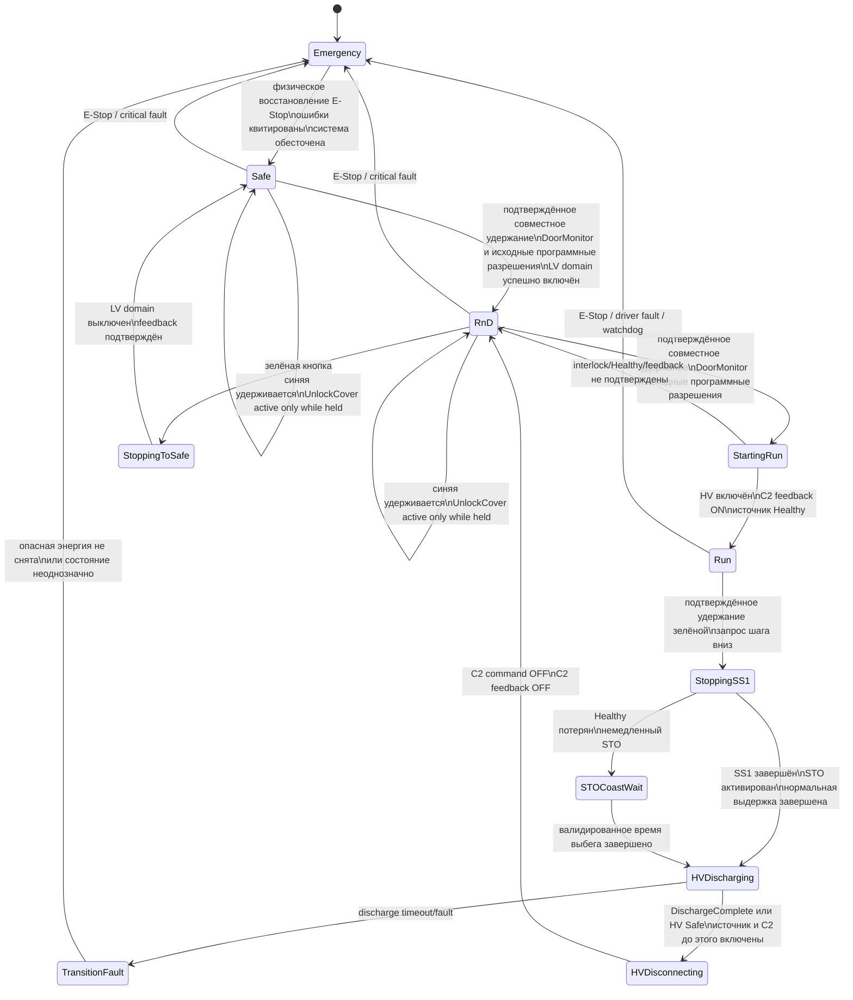

# MEN001 Dyno — спецификация Safety State Machine

Статус документа: рабочая спецификация желаемого поведения.  
Дата фиксации: 2026-10-17.  
Область: проект `MEN001_Dyno_v2`, TwinSAFE, управление энергетическими режимами и крышкой.

> Этот документ описывает требуемое поведение, а не подтверждает соответствие текущего кода. Текущая приёмка программная: SOFTWARE_ACCEPTANCE_SCOPE.md в SafetyTests. Native Verify/Build/CRC, загрузка и validation на установке вне этого задания и не подменяются тестами кода.

## 1. Назначение

Основа v2 — полная последовательность исходной работающей системы
MEN001_Dyno / Prodoction / 4495a1f. R&D добавляет устойчивую промежуточную
остановку и продолжение существующей последовательности; это не разрешение
перепроектировать её. Исходные фазы сопоставляются по коду и условиям, даже
если названия R&D там нет. Сохранённое поведение и намеренные изменения
фиксируются отдельно. Порядок источников для конкретного сценария: последнее
явное решение пользователя; утверждённое требование намеренного изменения;
reference для сохраняемой последовательности; предварительные/исторические
материалы. Неустранённое противоречие требует вопроса, а не нового oracle.

Документ является единой точкой сверки для:

- состояний установки;
- действий оператора;
- переходов вверх и вниз;
- SS1, STO и реакции на `HV Source Healthy`;
- разряда высокого напряжения;
- управления замком защитной крышки;
- условий завершения каждого перехода;
- дальнейших изменений логики и тестирования.

## 2. Основные состояния

| Состояние | LV domain | HV/C2 | Двигатели | Крышка |
|---|---|---|---|---|
| `Emergency` | Обесточен или переводится в безопасное состояние | Отключается по аварийной процедуре | STO, возможен выбег | Заблокирована |
| `Safe` | Выключен | Выключен, напряжение разряжено | STO | Может быть открыта разрешённой командой |
| `R&D` | Включён | Выключен, напряжение разряжено | STO | Может быть открыта удержанием синей кнопки |
| `Run` | Включён | Включён | Работа разрешена | Закрыта и заблокирована |

Переходные фазы не являются самостоятельными рабочими режимами:

- `StartingRun`;
- `StoppingSS1`;
- `STOCoastWait`;
- `HVDischarging`;
- `HVDisconnecting`;
- `StoppingToSafe`;
- `TransitionFault`.

## 3. Органы управления

| Управление | Назначение |
|---|---|
| Физический E-Stop | Переход из любого состояния в `Emergency` |
| Зелёная кнопка `Safety Reset` | После подтверждённого удержания — один шаг вниз по иерархии состояний |
| Синяя кнопка `Release Cover` | После подтверждённого удержания — временное разрешение разблокировки; соленоид активен только пока кнопка удерживается |
| Зелёная + синяя | После подтверждённого совместного удержания — один шаг вверх, только если текущий режим и все interlock разрешают переход |

Основная иерархия:

```text
Safe  <->  R&D  <->  Run
```

- зелёная кнопка: движение справа налево;
- две кнопки непрерывно 1 секунду: движение слева направо;
- синяя кнопка отдельно: не меняет энергетическое состояние, а только управляет разрешённой разблокировкой крышки.

### 3.1. Однозначное распознавание кнопок

Распознавание выполняется отдельной state machine. После каждой команды или невалидной попытки требуется полное отпускание обеих кнопок и непрерывный фильтр очистки.

Времена программного распознавания:

- `T_RELEASE_FILTER = 2 s` — обе кнопки непрерывно отпущены;
- `T_CHORD_WINDOW = 0.25 s` — вторая кнопка не позднее 250 мс после первой преобразует попытку в двухкнопочную;
- `T_SINGLE = 0.5 s` — подтверждение стабильной одиночной кнопки;
- `T_BOTH = 1 s` — подтверждение стабильного совместного удержания.

Решение пользователя 2026-10-18, переданное через координатора: «Оставим как
в эталоне было — полсекунды и секунду, переделай правила». Оно утверждает
`T_SINGLE = 0.5 s` для синей/зелёной и `T_BOTH = 1 s` вместо предварительных
1/2 s; существующие заданные таймеры SAL не менять. `T_RELEASE_FILTER = 2 s`
этим решением не изменён и остаётся предварительным. Последующее решение
D-CHORD250 утверждает `T_CHORD_WINDOW = 0.25 s` включительно и явно разрешает
изменить именно этот программный параметр; остальные заданные времена сохраняются.
Решение о длительностях не изменяет правила порядка кнопок, очистки и повтора.

Рекомендуемые состояния распознавателя:

```text
WaitAllReleased
 -> ReleaseQualify
 -> ArmedIdle
 -> GreenCandidate / BlueCandidate
 -> GreenActive / BlueActive
 -> TwoButtonsAttempt
 -> StepUpPulse
 -> WaitAllReleased
```

Требования:

1. В `ReleaseQualify` обе кнопки должны непрерывно оставаться `OFF` в течение `T_RELEASE_FILTER`. Любое нажатие до окончания фильтра аннулирует очистку; удерживаемая после этого кнопка не распознаётся. Нужны новое полное отпускание и полный фильтр.
2. После `ReleaseQualify` состояние `ArmedIdle` разрешает ровно одну новую попытку.
3. Первая нажатая кнопка переводит распознаватель в `GreenCandidate` или `BlueCandidate`. До завершения распознавания никакая команда и `UnlockCover` не выдаются.
4. Если зелёная остаётся единственной нажатой непрерывно `T_SINGLE`, формируется однократный `StepDown`.
5. Если синяя остаётся единственной нажатой непрерывно `T_SINGLE`, активируется `UnlockCover`; он остаётся активным только пока удерживается подтверждённая синяя и зелёная не нажата.
6. Если вторая кнопка нажата с интервалом `delta <= T_CHORD_WINDOW = 250 ms`
   после первой, распознаватель необратимо переходит в `TwoButtonsAttempt`.
   Правило симметрично для синей/зелёной первой; ровно 250 мс включено.
   При `delta > 250 ms` двухкнопочная команда из этой попытки запрещена.
7. В `TwoButtonsAttempt` одиночные команды запрещены. Обе кнопки должны одновременно и непрерывно оставаться `ON` в течение `T_BOTH = 1 s`, считая от появления второй кнопки, после чего формируется один импульс `StepUp`.
8. Если в `TwoButtonsAttempt` любой из двух входов пропал или моргает, таймер `T_BOTH` сбрасывается. При повторном появлении обеих кнопок отсчёт начинается заново, но попытка не понижается до зелёной или синей команды.
9. Если после входа в `TwoButtonsAttempt` одна кнопка остаётся нажатой, а вторая отпущена, система ничего не делает независимо от длительности такого состояния.
10. Выйти из `TwoButtonsAttempt`, `GreenActive`, `BlueActive` или состояния выполненной команды можно только после полного отпускания обеих кнопок и нового полного `T_RELEASE_FILTER`.
11. Последовательность `11 -> 10 -> 11` либо `11 -> 01 -> 11` никогда не создаёт одиночную команду.
12. Пример: синяя нажата на 0.5 секунды, затем отпущена и сразу удерживается зелёная. Команда не принимается: требуется полное отпускание обеих кнопок и новый `T_RELEASE_FILTER`.
13. Короткие повторяющиеся нажатия («игра на пианино») не вызывают действий.
14. Если вторая кнопка появилась после принятия одиночной команды, в том
    числе ровно на границе 500 мс или позже, это не создаёт двухкнопочную
    комбинацию и не запускает другую команду из той же попытки. Уже принятую
    команду не отменять, начатый переход не откатывать и не прерывать из-за
    поздней второй кнопки. Если вторая появилась позже250мс, но ДО принятия
    single, вся попытка игнорируется без fault: ни single, ни StepUp.
    В обоих случаях новая попытка требует полного отпускания ОБЕИХ кнопок
    и полного существующего release filter. Зелёная ON по-прежнему снимает
    UnlockCover; это удержание выхода, а не отмена события или откат перехода.

Историческое решение D-Q500 пользователя 2026-10-18: «Одиночная уже должна сработать, если
мы говорили про полсекунды». Правило симметрично для зелёной и синей первой.
Это приоритет квалификации одиночной попытки, а не гарантия видимого импульса
unlock при появлении зелёной в том же скане: зелёная запрещает UnlockCover
по п.5 и CVR-001. Длительность такого импульса этим решением не задаётся.
Последующее D-CHORD250 разносит границы: chord включительно до250 мс,
single500 мс. D-Q500 не разрешает chord в500 мс. Поздняя вторая кнопка до
квалификации single блокирует попытку по п14; новые реакции не добавляются.
Последующее D-LATE-SECOND явно разделяет до/после принятия single: до —
игнорировать всю попытку без fault; после — «Просто не начинать новое» без
отмены принятого и отката. Новое значение release filter не задано.

Главный инвариант:

> После распознавания попытки двух кнопок она никогда не может превратиться в одиночную команду без полного отпускания обеих кнопок и завершения нового фильтра очистки.

## 4. Общая диаграмма состояний



## 5. Управление крышкой

Действующее решение D-DOOR-CURRENT, 2026-10-19: сохранить обычный цифровой
`DoorMonitor` через PLC и программные условия исходного работающего проекта.
Не добавлять сейчас отдельное locked-feedback требование в launch guard.
Отдельное подтверждение блокировки отложено до обсуждения с инженером исходной
системы и нового ответа пользователя; оно не блокирует текущий workflow.
Существующие EStop/interlocks/прочие защитные цепи сохранить, не обходить.
`DoorMonitor` не объявляется safe-входом и не приравнивается к доказанному
closedANDlocked. Ни аппаратная валидация, ни корректность всех существующих
условий этим решением не подтверждаются: программные цепи нужно тестировать.

Замок имеет тип **normally locked / power-to-unlock**:

```text
UnlockCover = FALSE  -> крышка заблокирована
UnlockCover = TRUE   -> разрешено разблокировать крышку
```

Требования:

1. `UnlockCover` активируется только во время физического удержания синей кнопки.
2. Переход в `R&D` сам по себе не должен постоянно активировать соленоид.
3. В `Run` и во всех переходных фазах `UnlockCover = FALSE`.
4. После отпускания синей кнопки `UnlockCover` немедленно становится `FALSE`, но таймер ожидания закрытия не запускается.
5. Крышка может оставаться физически открытой неограниченно долго в `Safe` или `R&D`; это нормальное состояние и не является fault.
6. Существующий программный признак состояния крышки — `DoorMonitor` через PLC;
   его исходные условия использования сохраняются. Отдельный `CoverLockedFeedback`
   как новое условие отложен, его физический смысл здесь не устанавливается.
7. Для перехода вверх требуются `DoorMonitor = TRUE` и исходные действующие
   программные разрешения. Нового отдельного locked-feedback gate пока нет.
8. Команда соленоида не подменяет состояние входа; `UnlockCover = FALSE` не
   объявляется самостоятельным подтверждением механической блокировки.
9. Реакции существующих цепей на изменение DoorMonitor/защитных входов сохранить
   и проверить. Новое правило отдельного locked loss — отложенный объём,
   не обязательный hidden gate текущей приёмки.
10. При движении, HV или незавершённом discharge крышка остаётся заблокированной.
11. Если крышка открыта в `Safe` или `R&D`, команда шага вверх игнорируется: состояние не меняется и fault не фиксируется.

### 5.1. Interlock силовых разъёмов и внешней системы

- `in_LV_Connector_Interlock` подтверждает посадку Fast Charge connector 48 V/LV.
- `in_HV_Connector_Interlock` подтверждает посадку Fast Charge connector HV.
- В `Safe` отсутствие любого из этих контактов только блокирует переход вверх без fault; после восстановления требуется новый жест.
- После выхода из `Safe` потеря любого connector interlock считается аварийным событием.
- `in_InterLock_NC_1` и `in_InterLock_NC_2` сохраняются как двухканальный `External Emergency Interlock` из стабильной версии.
- Потеря любого канала External Emergency Interlock считается Emergency; восстановление контакта не отменяет начатую аварийную последовательность.

## 6. Переход Safe -> R&D

Инициатор:

```text
зелёная + синяя устойчиво удерживаются в течение `T_GESTURE`
```

Предварительные условия:

- нет активного Emergency;
- крышка закрыта;
- `DoorMonitor = TRUE` и исходные программные условия крышки выполнены;
- нет критических safety faults;
- нет противоречивых feedback контакторов;
- запрос является новым событием, а не оставшимся высоким уровнем.

Если крышка открыта, удержание двух кнопок не запускает переход и не создаёт ошибку.

Последовательность:

1. Принять запрос при `DoorMonitor = TRUE` и сохранённых исходных программных
   разрешениях; отдельный новый locked-feedback guard не вводить (D-DOOR-CURRENT).
2. Заблокировать возможность открытия крышки на время перехода.
3. Включить требуемую часть LV domain: PS1, battery relay и BMS согласно электрической последовательности.
4. Контролировать feedback каждого включаемого элемента и таймаут.
5. Оставить HV/C2 выключенным.
6. Оставить STO активным.
7. Только после всех подтверждений установить `State_RnD`.

## 7. Переход R&D -> Run

Инициатор:

```text
зелёная + синяя устойчиво удерживаются в течение `T_GESTURE`
```

Предварительные условия:

- `State_RnD` является единственным активным состоянием;
- `DoorMonitor = TRUE`, исходные разрешения крышки/защитных цепей сохранены;
- `UnlockCover = FALSE`;
- discharge request снят;
- LV domain исправен;
- источник питания готов;
- нет safety faults.

Если крышка открыта или замок не подтверждён до принятия команды, запрос вверх игнорируется без фиксации fault.

Последовательность:

1. Удерживать крышку заблокированной.
2. Подготовить регенеративный источник.
3. Включить C2/HV.
4. При принятом запуске снять STO (разрешить момент), не ожидая
   `C2_FBK = ON` или подтверждения `HV Source Healthy`.
5. Продолжить контроль C2 feedback и Healthy для подтверждения завершения
   запуска; только после требуемых подтверждений установить `State_Run`.
6. Сохранить аварийные запреты, interlocks и остальные разрешения запуска;
   разрешение раннего снятия STO не отменяет обработку отказа запуска.

Решение пользователя 2026-10-18: «Разрешаю мгновенно снятие STO, не надо ждать
фидбэка». Здесь снятие STO означает разрешение момента, поднятие STO — запрет.
«Мгновенно» — момент принятого программного запуска без ожидания указанного
feedback, не физически нулевое время. Это решение заменяет прежний порядок
снятия STO после C2/Healthy, но не разрешает считать StartingRun уже Run.
Трассировка: SCENARIO_DECISIONS.md D-STO-LAUNCH, MOD-002.

## 8. Переход Run -> R&D: нормальная остановка

Инициатор:

```text
устойчивое удержание только зелёной кнопки в течение `T_GESTURE`
```

Последовательность:

1. Перейти во внутреннюю фазу `StoppingSS1`; `State_RnD` ещё не устанавливать.
2. Активировать SS1 обоих AX5805.
3. Во время торможения оставить регенеративный источник и C2 включёнными.
4. Непрерывно контролировать `HV Source Healthy`.
5. Сертифицированная функция SS1 выполняет управляемую остановку и затем STO.
6. Выдержать валидированное нормальное время `T_SS1_Normal`, если нет пригодного safe feedback завершения SS1.
7. Перейти к `HVDischarging`.
8. Подать `Discharge Request`, пока источник и C2 ещё включены.
9. Дождаться `DischargeComplete` или физического `HV Safe`.
10. Только после подтверждённого discharge отключить источник/C2.
11. Дождаться `C2_FBK = OFF`.
12. Установить `State_RnD`.

Во время всей последовательности:

```text
UnlockCover = FALSE
DoorMonitor и существующие защитные условия контролируются по исходной логике
```

## 9. Потеря Healthy во время SS1

Условие:

```text
StoppingSS1 AND NOT HV_SourceHealthy
```

Обязательная реакция:

1. Немедленно прекратить регенеративную фазу SS1 посредством активации STO.
2. Зафиксировать fault `HealthyLostDuringSS1`.
3. Перейти в `STOCoastWait`.
4. Считать вращение возможным до истечения валидированного `T_STO_Coast`.
5. Не открывать крышку и не объявлять `R&D`.
6. После времени выбега выполнить discharge при включённом источнике/C2, если источник допускает discharge в состоянии `Healthy = FALSE`.
7. После подтверждения discharge отключить C2 и дождаться `C2_FBK = OFF`.
8. Только затем разрешить завершение перехода в `R&D`; fault остаётся зафиксированным до осознанного reset.

`T_STO_Coast` должен соответствовать худшему случаю: максимальная скорость и инерция, минимальное сопротивление, отсутствие регенеративного торможения.

## 10. Discharge высокого напряжения

Обязательный порядок:

```text
двигатели переведены в STO / ожидание завершено
-> источник включён
-> C2 включён
-> Discharge Request = TRUE
-> DischargeComplete или HV Safe
-> C2 command = OFF
-> C2 feedback = OFF
-> R&D
```

Запрещено:

- открывать C2 до запуска discharge;
- считать одну только выдержку времени доказательством безопасного напряжения, если доступен физический feedback;
- входить в `R&D` при `C2_FBK = ON`;
- разрешать крышку до подтверждения безопасного HV;
- автоматически продолжать переход после discharge timeout.

При discharge timeout:

```text
State = TransitionFault
UnlockCover = FALSE
ошибка фиксируется
```

## 11. Переход R&D -> Safe

Инициатор:

```text
устойчивое удержание только зелёной кнопки в течение `T_GESTURE`
```

Предварительно HV уже должен быть разряжен и C2 выключен.

Последовательность:

1. Запретить открытие крышки на время переключения.
2. Выключить LV loads в определённой электрической последовательности.
3. Отключить battery relay и BMS relay.
4. Выполнить LV discharge, если он требуется схемой.
5. Проверить feedback отключения.
6. Установить `State_Safe`.

## 12. Переход Emergency -> Safe

Переход выполняется только физической процедурой:

1. Устранена причина аварии.
2. Физический E-Stop возвращён в нормальное положение.
3. Все опасные энергии сняты.
4. Feedback контакторов соответствует выключенному состоянию.
5. Выполнено разрешённое ручное квитирование.
6. Система входит только в `Safe`, но никогда автоматически в `R&D` или `Run`.

PLC не имеет права отменять защёлкнутый `Emergency`.

## 13. Приоритеты логики

От высшего приоритета к низшему:

1. Emergency и потеря критического safety feedback.
2. Немедленный STO при потере `Healthy` во время SS1.
3. Переходы вниз, уменьшающие энергию.
4. Переходы вверх, добавляющие энергию.
5. Удержание текущего состояния.

Если одновременно обнаружено несколько состояний или не активно ни одного допустимого состояния:

```text
StateConflict -> Emergency/TransitionFault
```

## 14. Правило one-hot

В каждый момент должно быть активно ровно одно основное состояние:

```text
Emergency XOR Safe XOR R&D XOR Run
```

Переходные фазы хранятся отдельно и не должны маскироваться как рабочее состояние. PLC/HMI посылает только запрос; TwinSAFE самостоятельно проверяет условия и изменяет состояние.

Рекомендуемый интерфейс:

```text
Commands PLC -> TwinSAFE:
  CMD_STEP_UP
  CMD_STEP_DOWN
  CMD_EMERGENCY

Status TwinSAFE -> PLC:
  STS_EMERGENCY
  STS_SAFE
  STS_RND
  STS_RUN
  STS_TRANSITION_ACTIVE
  STS_TRANSITION_FAULT
  STS_COVER_CLOSED
  STS_COVER_LOCKED  // возможное будущее расширение, не текущий обязательный сигнал
  STS_HV_SAFE
```

Команда должна обрабатываться как новое событие с handshake, а не как постоянно установленный двухбитный код.

## 15. Минимальная таблица действий оператора

| Текущее состояние | Зелёная после `T_GESTURE` | Синяя после `T_GESTURE` | Обе после `T_GESTURE` |
|---|---|---|---|
| `Emergency` | Не выполняет переход вверх | Не открывает крышку до безопасного восстановления | Не выполняет переход |
| `Safe` | Остаётся в `Safe` | Разблокировка только пока удерживается, если все условия доступа выполнены | `Safe -> R&D` |
| `R&D` | `R&D -> Safe` | Разблокировка только пока удерживается | `R&D -> Run` |
| `Run` | `Run -> R&D` через SS1/discharge | Игнорируется, крышка остаётся закрытой | Не является командой вверх; переход вниз имеет приоритет |
| Любой Transition | Новая команда не принимается либо трактуется как запрос abort-down | Крышка остаётся заблокированной | Новая команда вверх не принимается |

Для `Safe` и `R&D`: если крышка открыта, комбинация зелёной и синей кнопок игнорируется без изменения состояния и без регистрации ошибки.

## 16. Требующие подтверждения пункты

Обновление объёма 2026-10-18: физические вопросы этого раздела находятся вне
текущего задания и не блокируют программные проверки. Аппаратная конфигурация
принята проверенным исходным условием. Текущие времена SAL не меняются;
предварительные программные требования остаются явно отмеченными. Неясные
программные значения completion/feedback и последовательности требуют
адресного уточнения без исследования проводки. См. AGENTS.md.

Перед финальной реализацией необходимо подтвердить:

1. Точную электрическую полярность `HV Source Healthy` и `LV Healthy`.
2. Снимается ли `Healthy` штатно во время discharge.
3. Может ли источник выполнить discharge после потери `Healthy`.
4. Какой физический сигнал подтверждает `DischargeComplete` или `HV Safe`.
5. Значения `T_SS1_Normal`, `T_STO_Coast` и максимального discharge timeout.
6. Смысл feedback AX5805: факт запроса STO или фактическое безопасное состояние функции.
7. Окончательно подтвердить предварительный `T_RELEASE_FILTER = 2 s`. `T_SINGLE = 0.5 s`, `T_BOTH = 1 s` и включительное `T_CHORD_WINDOW = 0.25 s` утверждены пользователем 2026-10-18; их повторное согласование не требуется.
8. Точная последовательность отключения LV, battery relay и BMS при `R&D -> Safe`.
9. Требуемая аварийная последовательность discharge при общем E-Stop.

## 17. Критерии приёмки

- Ни один одиночный PLC-бит не может непосредственно включить опасную энергию.
- Переход вверх требует существующего DoorMonitor и исходных программных разрешений; отдельный locked-feedback guard отложен D-DOOR-CURRENT.
- Синяя кнопка не меняет режим и включает unlock-соленоид только во время удержания.
- Одиночная команда не выполняется до непрерывного истечения `T_SINGLE`.
- Вторая кнопка с интервалом `delta <= 250 ms` необратимо переводит попытку в `TwoButtonsAttempt`; `delta > 250 ms` не создаёт StepUp. BOTH1с считается от появления второй кнопки. Проверять обе очередности и границы до/ровно/после250мс (D-CHORD250).
- `StepUp` не выполняется до непрерывного одновременного удержания обеих кнопок в течение `T_BOTH`.
- Пропадание или моргание одной кнопки в `TwoButtonsAttempt` сбрасывает `T_BOTH`, но никогда не создаёт одиночную команду.
- Быстрое «пианино» не вызывает команд.
- Перед каждой новой попыткой обе кнопки должны непрерывно оставаться отпущенными не менее `T_RELEASE_FILTER`.
- Нажатие до окончания `T_RELEASE_FILTER` отклоняется полностью и не может стать командой за счёт дальнейшего удержания.
- После выполненной команды требуется полное отпускание обеих кнопок и новый цикл `T_RELEASE_FILTER`.
- Потеря `Healthy` во время SS1 немедленно активирует STO.
- После аварийного STO крышка остаётся закрытой минимум `T_STO_Coast`.
- Discharge запускается до отключения C2.
- C2 отключается только после подтверждения discharge либо согласованной валидированной процедуры отказа.
- `R&D` не устанавливается до подтверждения безопасного HV и `C2_FBK = OFF`.
- `Safe` не устанавливается до подтверждения снятия LV domain.
- При неоднозначных состояниях система переходит в безопасную ошибку.
- После рестарта система не восстанавливает `Run` автоматически.

## 18. Журнал изменений спецификации

| Дата | Изменение |
|---|---|
| 2026-10-17 | Создана исходная спецификация по результатам обсуждения и анализа `v2` |
| 2026-10-17 | Согласована state machine распознавания зелёной, синей и двух кнопок с отдельным `TwoButtonsAttempt` и обязательным фильтром очистки |
| 2026-10-18 | По явному решению пользователя одиночные синяя/зелёная 0.5 s, совместное удержание 1 s; прежние предварительные 1/2 s заменены. Release filter и chord window не изменены |
| 2026-10-18 | D-STO-LAUNCH: STO снимается при принятом R&D→Run launch без ожидания C2/HV Healthy feedback; Run подтверждается отдельно. Основа v2 — сохранённая полная последовательность reference с устойчивой промежуточной остановкой R&D |
| 2026-10-18 | D-Q500: на общей границе single/chord 500 мс одиночная команда уже принята и имеет приоритет; новая двухкнопочная попытка из неё не создаётся. Симметрично для обеих первых кнопок |
| 2026-10-18 | Последующее D-CHORD250: окно второй кнопки delta<=250мс включительно; BOTH1с от второй, SINGLE0.5с без изменения. Разрешено изменить именно программное окно. D-Q500 не задаёт chord500 |
| 2026-10-18 | D-LATE-SECOND: >250мс до принятой single — игнорировать попытку без fault; после принятой single — не отменять/откатывать переход, только не принимать новое до отпускания обеих и фильтра. Ровно500мс приоритет single |
| 2026-10-19 | D-DOOR-CURRENT: сохранить обычный цифровой DoorMonitor через PLC и исходные программные условия. Новое отдельное locked-feedback требование отложено до инженера/нового решения; не блокирует workflow, EStop/interlocks не обходить |

## 19. Идентификаторы аварийных требований

Добавлено 2026-10-18 для трассировки существующих правил; эта таблица не
утверждает новые аппаратные времена, полярности или последовательности.
Идентификаторы сохраняются при последующих уточнениях.

| ID | Существующее требование | Основание |
|---|---|---|
| EMG-001 | Физический E-Stop из любого основного режима или перехода начинает аварийную последовательность | §§2–4, 13 |
| EMG-002 | Потеря любого канала внешнего аварийного interlock вызывает Emergency | §5.1 |
| EMG-003 | В Safe отсутствие connector interlock только блокирует повышение без fault; после восстановления нужен новый жест | §5.1 |
| EMG-004 | После выхода из Safe потеря любого connector interlock считается аварийным событием | §5.1 |
| EMG-005 | Восстановление защитного входа не отменяет начатую аварийную последовательность | §5.1; §9 для Healthy |
| EMG-006 | После аварии только ручное восстановление в Safe с подтверждённо снятой энергией; PLC не снимает защёлкнутый Emergency | §12 |
| EMG-007 | Крышка не разблокируется в Emergency и переходах либо при незавершённом снятии опасной энергии | §§5, 8–10, 15 |
| EMG-008 | Потеря Healthy во время SS1 немедленно выбирает STO без общей предварительной выдержки | §§9, 13 |
| EMG-009 | После выбора аварийного STO восстановление Healthy не возвращает SS1 и не сокращает полный coast wait | §9 |
| EMG-010 | Discharge начинается при подключённом источнике/C2; отключение C2 и вход R&D требуют утверждённого подтверждения/отказной процедуры и feedback | §§8, 10, 17 |
| EMG-011 | Аварийные условия имеют приоритет над повышением энергии; повышение требует актуальных interlock и feedback | §§5.1, 6–7, 13 |
| EMG-012 | Неоднозначная комбинация состояний приводит в Emergency/TransitionFault | §§13–14 |

Привязка к наблюдениям и пробелам: `SafetyTests/EMERGENCY_REQUIREMENTS.md`.
Это первый набор ID; продолжение для остальных групп приведено в §20.

## 20. Идентификаторы остальных групп требований

Эти ID уточняют трассировку существующих правил без изменения их смысла.
Одиночное удержание 0.5 s и совместное 1 s утверждены решением 2026-10-18;
chord window250мс включительно утверждено последующим D-CHORD250; release filter
остаётся предварительным. Аппаратные параметры
из §16 этой таблицей не утверждаются. EMG-ID из §19 также применяются.

| ID | Требование | Основание |
|---|---|---|
| BTN-001 | Перед новой попыткой обе кнопки непрерывно отпущены полный release filter | §3.1 пп.1–2,10,14 |
| BTN-002 | Нажатие до окончания очистки полностью отклоняется; удержание не легализует его | §3.1 п.1; §17 |
| BTN-003 | Одиночная зелёная выдаёт один StepDown после полного непрерывного T_SINGLE | §3.1 п.4 |
| BTN-004 | Одиночная синяя квалифицируется полным T_SINGLE; до этого unlock запрещён | §3.1 пп.3,5 |
| BTN-005 | Вторая кнопка delta<=250мс включает необратимую TwoButtonsAttempt; позже250мс StepUp запрещён | §3.1 пп.6–7; D-CHORD250 |
| BTN-006 | StepUp требует полного непрерывного T_BOTH; потеря кнопки сбрасывает таймер | §3.1 пп.7–8 |
| BTN-007 | Неудачная/мигающая комбинация не превращается в одиночную команду до полной очистки | §3.1 пп.8–13 |
| BTN-008 | Выполненная команда не повторяется; поздняя вторая до single блокирует попытку без fault, после single не отменяет принятую и не создаёт новую до полной очистки | §3.1 пп.10,14; D-LATE-SECOND |
| CVR-001 | Power-to-unlock активен только при удержании квалифицированной синей без зелёной | §§3.1,5 |
| CVR-002 | Safe и R&D допускают удерживаемое открытие без постоянного включения соленоида от режима | §5 пп.1–4 |
| CVR-003 | Открытая крышка может оставаться открытой в Safe/R&D без timeout/fault | §5 пп.4–6 |
| CVR-004 | Текущий объём: повышение требует DoorMonitor и исходных программных разрешений; открытая крышка блокирует без fault. Новое отдельное locked-feedback условие отложено | §5 пп.6–8,11; D-DOOR-CURRENT |
| CVR-005 | Unlock и повышение энергии не могут сосуществовать | §§5–7,17 |
| CVR-006 | Текущий объём: сохранить и проверить исходные реакции на DoorMonitor/защитные входы при опасной энергии; отдельный locked-loss контракт отложен | §5 пп.9–10; D-DOOR-CURRENT |
| MOD-001 | Safe -> R&D включает LV последовательно и устанавливает R&D только после feedback | §6 |
| MOD-002 | R&D -> Run устанавливает Run только после interlock, C2 и Healthy подтверждений | §7 |
| MOD-003 | Каждый шаг вверх требует нового события, а не удерживаемого PLC уровня | §§6–7,14,17 |
| MOD-004 | Новые команды вверх во время перехода не принимаются | §§5,15 |
| MOD-005 | R&D -> Safe снимает LV/battery/BMS по утверждённой последовательности до Safe | §11 |
| MOD-006 | Основные режимы имеют однозначное владение; фазы отдельно от режимов | §§2,14 |
| MOD-007 | PLC передаёт запрос; TwinSAFE самостоятельно проверяет переход, одиночный PLC-бит не включает энергию | §§14,17 |
| MOD-008 | Неоднозначный/неподтверждённый feedback запрещает повышение | §§6–7,17 |
| STP-001 | Штатный Run -> R&D выполняет SS1/STO с подключённым регенеративным источником/C2 | §8 |
| STP-002 | После SS1/coast discharge идёт до отключения C2; соблюдается EMG-010 | §§8–10 |
| STP-003 | Отсутствие discharge completion до timeout фиксирует fault и запрещает автоматическое продолжение | §10 |
| STP-004 | R&D не устанавливается до safe-HV/утверждённого завершения и C2 OFF feedback | §§8,10,17 |
| STP-005 | Safe не устанавливается до подтверждения снятия LV | §§11,17 |
| BOOT-001 | При старте/рестарте Run не восстанавливается автоматически | §§4,12,17 |
| BOOT-002 | Зажатые при старте кнопки не принимаются до отпускания и полного release filter | §3.1; план A02–A04 |

План недостающих положительных/отрицательных сценариев и граница baseline:
`SafetyTests/ACCEPTANCE_BACKLOG.md`. Таблица покрывает группы требований;
детальная атомизация каждого аппаратного feedback и timeout продолжается
после согласования сигналов/параметров §16.

